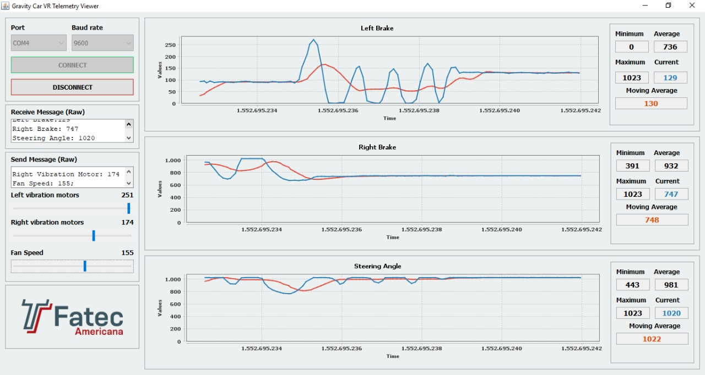

# Gravity Car VR Desktop Monitor

Java desktop telemetry application for the Gravity Car VR simulator.

## Getting started

- Import the repository as an existing Maven project. Review its Java version, database configuration and dependencies before building.

- For projects with a database or serial device, configure those dependencies explicitly; this guide does not start external services or equipment.

## Recorded requirements

- A JDK compatible with the compiler settings in [`pom.xml`](https://github.com/kleberandrade/gravity-car-vr-desktop-monitor/blob/master/pom.xml) and Maven.

## Repository map

- [pom.xml](https://github.com/kleberandrade/gravity-car-vr-desktop-monitor/blob/master/pom.xml)
- [src](https://github.com/kleberandrade/gravity-car-vr-desktop-monitor/tree/master/src)

## Validation status

This update documents the tracked source and project metadata. It does not certify a successful build, device test or compatibility with a current toolchain. Follow any project-specific validation instructions in the original material.

## License and attribution

See [LICENSE](https://github.com/kleberandrade/gravity-car-vr-desktop-monitor/blob/master/LICENSE) and any notices accompanying third-party code and assets. This documentation update does not change licensing or authorship.

---

## Original project material

# Gravity Car VR Desktop Monitor (Telemetria)

Sistema de telemetria do simulador imersivo de carrinho de rolimã.

  

## Interface

  

## Créditos
*   Maiara de Carvalho Martins
*   Tiago Guerino de Oliveira Bassani
*   Kleber de Oliveira Andrade (Orientador)

## Licença

    Copyright 2018-2019 Fatec Americana
    
    Permission is hereby granted, free of charge, to any person obtaining a copy
    of this software and associated documentation files (the "Software"), to deal
    in the Software without restriction, including without limitation the rights
    to use, copy, modify, merge, publish, distribute, sublicense, and/or sell
    copies of the Software, and to permit persons to whom the Software is
    furnished to do so, subject to the following conditions:
    
    The above copyright notice and this permission notice shall be included in all
    copies or substantial portions of the Software.
    
    THE SOFTWARE IS PROVIDED "AS IS", WITHOUT WARRANTY OF ANY KIND, EXPRESS OR
    IMPLIED, INCLUDING BUT NOT LIMITED TO THE WARRANTIES OF MERCHANTABILITY,
    FITNESS FOR A PARTICULAR PURPOSE AND NONINFRINGEMENT. IN NO EVENT SHALL THE
    AUTHORS OR COPYRIGHT HOLDERS BE LIABLE FOR ANY CLAIM, DAMAGES OR OTHER
    LIABILITY, WHETHER IN AN ACTION OF CONTRACT, TORT OR OTHERWISE, ARISING FROM,
    OUT OF OR IN CONNECTION WITH THE SOFTWARE OR THE USE OR OTHER DEALINGS IN THE
    SOFTWARE.
